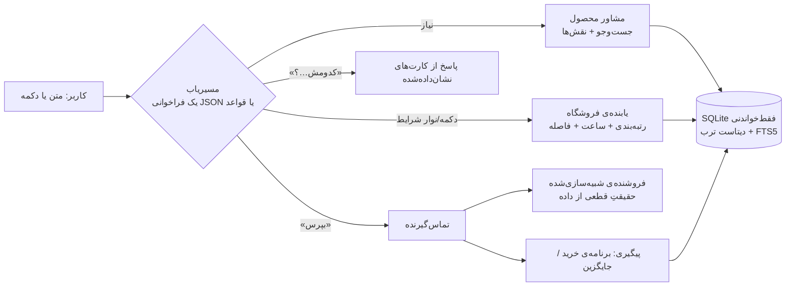

# دستیار خرید حضوری — چالش ترب (هکاتون Agentic AI استارکوچ)

**«بگو چی لازم داری؛ مدل‌ها رو مقایسه می‌کنم، فروشنده‌های نزدیکت رو پیدا می‌کنم و قبل از رفتن ازشون می‌پرسم.»**

- نسخه‌ی زنده: https://torob.frontage.store
- ویدئوی دمو: _(لینک بعد از ضبط)_
- پشت صحنه (برای داوران): https://torob.frontage.store/admin

یک صفحه، فارسی و راست‌به‌چپ، برای موبایل. داده فقط از **دیتاست ترب**؛ هیچ فراخوانی زنده‌ای به ترب نمی‌شود.

---

## ۱. مسئله و چهار قدم (طبق ویدئوی چالش)

| قدم | در محصول |
|---|---|
| ۱. کاربر نمی‌داند چه مدلی بخرد | یک سؤال کوتاه با گزینه، بعد **۲ تا ۳ محصول کنار هم**، هر کدام با برچسب درست («بهترین ارزش»، «ارزان‌ترین»، «بیشترین فروشنده») و خط «چرا» که فقط از داده ساخته شده |
| ۲. فروشگاه‌های نزدیکِ دارای کالا | فروشگاه‌هایی که **این کالا را ثبت کرده‌اند**، در شعاع انتخابی، با طبقه و واحد داخل پاساژ |
| ۳. مقایسه‌ی فروشگاه‌ها (قیمت، فاصله، ساعت) | سه کارت با ردیف‌های یکسان: قیمت ثبت‌شده و تاریخش، موجودی (تأیید نشده)، زمان پیاده‌روی تخمینی و «باز تا …» در لحظه‌ی رسیدن |
| ۴. ارتباط با فروشگاه | **تماس شبیه‌سازی‌شده** که فقط چیزهای نامعلوم یا قدیمی را می‌پرسد، بعد «برنامه‌ی خرید» یا یک جایگزین با دلیل |

و پنج درد ویدئو:

- **مدل را نمی‌داند:** مشاور قدم ۱.
- **قیمت قدیمی است:** سن قیمت روی هر قیمت؛ تماس می‌پرسد.
- **جواب نمی‌دهد یا بسته است:** جایگزین فوری با دلیل.
- **مغازه را داخل پاساژ پیدا نمی‌کند:** طبقه، واحد و پلاک از متن آدرس.
- **فقط قسطی:** فیلتر قسطی و قسطیِ حضوری، با جایگزین وقتی چیزی نماند.

## ۲. چطور کار می‌کند



- **مسیریاب (step machine):** برای هر پیام متنی حداکثر **یک** فراخوانی LLM با خروجی JSON. بقیه را کد تصمیم می‌گیرد. دکمه‌ها و نوار شرایط **بدون LLM** اجرا می‌شوند. اگر LLM خاموش باشد یا خطا بدهد، قواعد فارسی جایش را می‌گیرند. LLM در حالت پیش‌فرض خاموش است (`LLM_ENABLED=0`) و محصول کامل کار می‌کند.
- **عددها همیشه از کد می‌آیند:** قیمت، فاصله، ساعت، رتبه و برچسب‌ها. مدل هیچ عددی نمی‌سازد.
- **چندعاملی (صادقانه):**
  - مسیریاب؛
  - مشاور محصول (`agents/advisor.py`)؛
  - یابنده و رتبه‌دهنده‌ی فروشگاه (`agents/shops.py`)؛
  - تماس‌گیرنده و فروشنده‌ی شبیه‌سازی (`agents/call.py`)؛
  - پیگیری (`agents/followup.py`).

## ۳. دیتاست: چه کردیم و چه را شفاف نشان می‌دهیم

| موضوع | کار |
|---|---|
| سه چیز جدا | «قیمت ثبت‌شده»، «سن قیمت» (مثلاً «۳ هفته پیش») و «موجودی: تأیید نشده» همیشه جدا هستند. فقط تماس می‌تواند موجودی را عوض کند، آن هم با برچسب «شبیه‌سازی». |
| نامعلوم | ساعت ثبت‌نشده با «ساعت کاری ثبت نشده» و قیمت ثبت‌نشده با «قیمت ثبت نشده» نشان داده می‌شود؛ هیچ‌وقت حدس زده نمی‌شود. |
| فقط دسته‌ی مرتبط | فروشگاهی که فقط دسته‌ی فعالیتش جور است جدا فهرست می‌شود: «این مدل رو ثبت نکرده — موجودی نامعلوم». رابطه‌ی دسته‌های کلی فروشگاه و دسته‌های جزئی محصول از روی فروشنده‌های واقعی یاد گرفته شده. |
| قیمت مشکوک | قیمت مشکوک (بیش از ۳ برابر یا کمتر از یک‌سوم میانه‌ی همان محصول، یا اعداد بی‌معنی مثل ۷×۱۰¹⁷) کنار گذاشته و با یک خط خاکستری شمرده می‌شود: «۶ قیمت مشکوک کنار گذاشته شد». این قیمت‌ها هرگز «ارزان‌ترین» نمی‌شوند. |
| داخل پاساژ | نام پاساژ، طبقه، واحد و پلاک از متن آدرس استخراج می‌شود: در ۴٬۱۵۹ از ۴٬۲۲۴ آدرسی که طبقه دارند. املاهای مختلف («علاالدین / علاءالدین / علائدین») یکی می‌شوند و نشانه‌هایی مثل «روبروی پاساژ …» نادیده گرفته می‌شوند. |
| ساعت کاری | جمعه‌های «یک‌ثانیه‌ای» (۰۰:۰۰:۰۰ تا ۰۰:۰۰:۰۱) که در ۵۸ فروشگاه وجود دارد، به‌عنوان «۲۴ ساعته» خوانده نمی‌شوند. |
| داده‌ی خراب | ۸۴۹ محصول با عنوان «عنوان حذف‌شده برای انتشار» هرگز نمایش داده نمی‌شوند. چند محصولی که عنوانشان یکی است ادغام می‌شوند. |
| پوشش | ۸۵٪ فروشگاه‌ها اطراف جمهوری و فردوسی هستند. بیرون از این محدوده محصول صادقانه می‌گوید و «جمهوری/فردوسی» یا «کل تهران» را پیشنهاد می‌دهد. |

جزئیات بیشتر در `Torob/DATASET-NOTES.md` در مخزن برنامه‌ریزی.

## ۴. تماس شبیه‌سازی‌شده؛ چرا و چطور

شماره‌ی همه‌ی فروشگاه‌ها در دیتاست ساختگی است، پس تماس واقعی ممکن نیست. به‌جای ادعای دروغ، **شبیه‌سازی صادقانه** ساختیم.

- **سؤال‌ها از کمبودهای داده ساخته می‌شوند.** نمونه‌ی خط دلیل: «می‌پرسم چون: قیمت ۳ هفته پیش ثبت شده، داخل پاساژه، دنبال قسطی هستی».
- **حقیقت قطعی است.** پاسخ فروشنده از یک حقیقتِ قطعی می‌آید که با فروشگاه، کالا و روز ثابت می‌شود:
  - موجودی با احتمال وابسته به سن قیمت؛
  - قیمت امروز به‌صورت قیمت ثبت‌شده به‌اضافه‌ی تورم ماهانه؛
  - ساعت، روش پرداخت و نشانی **فقط از دیتاست**؛ هیچ‌کدام ساخته نمی‌شود.
- **برچسب همیشه دیده می‌شود.** هر نتیجه، کارت و برنامه برچسب «شبیه‌سازی» و حاشیه‌ی کهربایی خط‌چین دارد. ردیف‌های دیتاست هیچ‌وقت آن ظاهر را نمی‌گیرند.
- **تکرارپذیر است.** با `DEMO_NOW` (ساعت ثابت)، `SIM_OVERRIDES` (اجبار «جواب نداد/ناموجود») و `SIM_SEED_DATE`، دمو دقیقاً تکرار می‌شود.
- **مسیر واقعی:** همین قرارداد با یک عامل تماس صوتی (TTS/STT، مثل «Let Google Call») یا پیام بله/واتساپ پیاده می‌شود. نتیجه‌ی آن تماس‌ها داده‌ی «تازگی قیمت» است که ترب امروز ندارد.

## ۵. نقشه‌ی معیارهای داوری

| معیار (امتیاز) | چه چیزی | کجا دیده می‌شود |
|---|---|---|
| محصول (۷۵) | هر چهار قدم و پنج درد ویدئو؛ جست‌وجو، مقایسه، فروشنده در محدوده، پیگیری | ویدئو؛ نسخه‌ی زنده |
| تجربه‌ی کاربری (۷۵) | یک صفحه؛ نوار شرایط قابل ویرایش (محدوده، بودجه، پرداخت، باز بودن، زمان رسیدن)؛ کارت‌های کنار هم؛ گزینه‌ها؛ یک دکمه‌ی اصلی در هر کارت؛ «چرا» و قدم بعدی روشن؛ RTL موبایل | نسخه‌ی زنده |
| هوشمندی (۵۰) | تماس با دلیل؛ جایگزین فوری با دلیل (جواب نداد، ناموجود، بسته در لحظه‌ی رسیدن، قسطی نبود)؛ «باز تا وقتی برسی»؛ «برای شنبه ۱۰ صبح نشون بدم؟»؛ هم‌پاساژی‌ها؛ برنامه‌ی خرید که با تغییر شرایط دوباره بررسی می‌شود | ویدئو |
| دیپلوی (۴۰) | لیارا + دامنه‌ی `torob.frontage.store`؛ دیسک برای دیتابیس؛ `/health`؛ محدودیت نرخ؛ سقف مصرف | نسخه‌ی زنده، `/health`، `/admin` |
| پیاده‌سازی فنی (۴۰) | FastAPI، SQLite+FTS5، SSE، چندعاملیِ مبتنی بر کد، ۲۰۰+ تست، FakeLLM برای تست بدون هزینه، بازبینی هر مرحله | این مخزن، `torob/tests` |
| دیتاست (۲۰) | هر سه جدول؛ سه برچسب جدا؛ نامعلوم‌ها؛ قیمت مشکوک؛ فقط‌دسته؛ پاساژ، طبقه و واحد | بخش ۳ |

## ۶. ایمنی و هزینه

- عامل **چانه نمی‌زند، خرید نمی‌کند و قول نمی‌دهد.** متن کاربر یا فروشگاه داده است، نه دستور.
- LLM پیش‌فرض خاموش است. وقتی روشن باشد، **سقف توکن روزانه و هر نشست قبل از هر فراخوانی** چک می‌شود، پاسخ خراب به ارائه‌دهنده‌ی بعدی می‌رود و کلید فقط در هدر است.
- محدودیت نرخ: ۲۰ درخواست در دقیقه برای هر IP، و در هر نشست یک نوبت هم‌زمان.
- دکمه‌ها با شِمای جدا اعتبارسنجی می‌شوند: فقط محصول یا فروشگاهی که نشان داده شده قابل تماس است.
- همه‌ی متن‌ها در صفحه با `textContent` نوشته می‌شوند (بدون HTML).

## ۷. اجرا

```bash
uv sync
uv run python -m torob.etl.build_db --csv-dir path/to/v16 --out data/torob.db   # حدود ۲۰ ثانیه
uv run uvicorn torob.app:app --port 8770
uv run pytest -q
```

| متغیر | پیش‌فرض | کار |
|---|---|---|
| `TOROB_DB` / `TOROB_APP_DB` | `data/torob.db` / `data/app.db` | دیتابیس دیتاست (فقط‌خواندنی) / نشست‌ها و رویدادها |
| `LLM_ENABLED` | `0` | `1` = استفاده از ارائه‌دهنده‌ها (`LLM_PRIMARY_*`، `LLM_FALLBACK_*`، `MODEL_*`) |
| `LLM_DAILY_TOKENS` / `LLM_SESSION_TOKENS` | `200000` / `20000` | سقف مصرف |
| `CALL_LLM` | `0` | `1` = بازنویسی جمله‌های فروشنده با LLM (عددها نباید عوض شوند) |
| `DEMO_NOW` · `SIM_OVERRIDES` · `SIM_SEED_DATE` | — | دموی تکرارپذیر |
| `CALL_LINE_DELAY` | `0.7` | مکث بین جمله‌های تماس |
| `TRUST_PROXY` | `0` | پشت پراکسی لیارا: آخرین IP در `X-Forwarded-For` |

## ۸. محدودیت‌ها و ادامه

- **فیلدهای غایب از خروجی دیتاست:** کالابرگ، تصویر فروشگاه، مجوزها، توضیح فروشگاه، واتساپ و بله. نمایش داده نمی‌شوند.
- **نام‌ها و شماره‌ها ساختگی‌اند.** تماس‌ها شبیه‌سازی است.
- قیمت‌ها به تومان فرض شده‌اند.
- **پوشش:** حدود ۱۰٪ فروشگاه‌های تهران ترب، بیشتر اطراف جمهوری و فردوسی.
- **زمان رسیدن تخمینی است:** فاصله‌ی مستقیم × ۱٫۳ با سرعت پیاده. اتصال به نشان (Neshan) برای مسیر واقعی هنوز ساخته نشده و قابل افزودن است.
- **ادامه:**
  - تماس صوتی یا پیام واقعی با فروشگاه‌های همکار؛
  - ماژول درون «تربچت»؛
  - صفحه‌ی پاساژ («۱۴ فروشنده‌ی این مدل در علاءالدین»).
