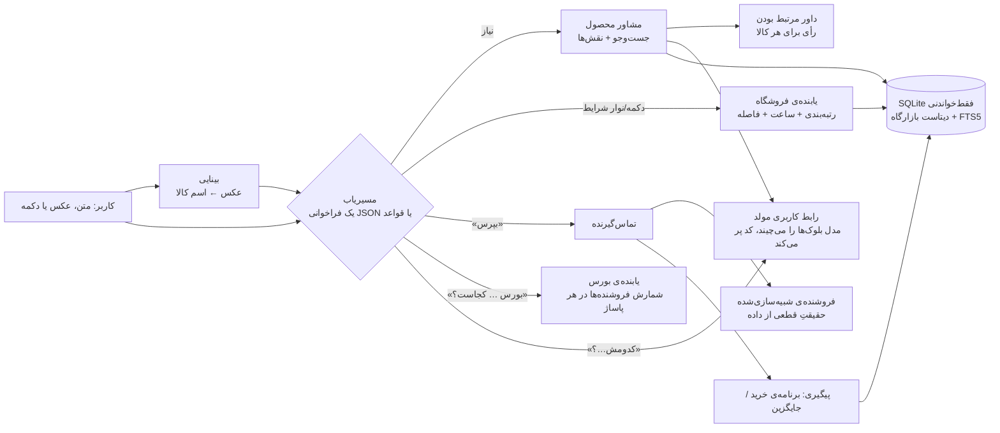

# دستیار⁤⁤⁤⁤⁤⁤⁤⁤⁤⁤⁤⁤⁤⁤⁤⁣، دستیار خرید حضوری — چالش بازارگاه⁤⁤⁤⁤⁤⁤⁤⁤⁤⁤⁤⁤⁤⁤⁤⁤⁣ (هکاتون Agentic AI⁤⁣)

**«بگو چی لازم داری؛ مدل‌ها رو مقایسه می‌کنم، فروشنده‌های نزدیکت رو پیدا می‌کنم و قبل از رفتن ازشون می‌پرسم.»**

- نسخه‌ی زنده: https://torob.frontage.store _(روی سرور اختصاصی در ایران، با هوش مصنوعی روشن؛ اجرای محلی با دستورهای بخش ۸)_
- ویدئوی دمو: _(لینک بعد از ضبط؛ برنامه‌ی ضبط در [`docs/VIDEO-SHOT-LIST.md`](docs/VIDEO-SHOT-LIST.md))_
- آزمون فشار: بیش از ۱۰۰ گفت‌وگوی نامرتب، بی‌ربط و خراب‌کارانه با نتیجه و ایرادهای درست‌شده در [`docs/STRESS-TEST.md`](docs/STRESS-TEST.md)
- پشت صحنه (برای داوران): `/admin` روی همان دامنه: آمار دیتاست، مدل و مصرف توکن، زمان پاسخ و نتیجه‌ی تماس‌ها

یک صفحه، فارسی و راست‌به‌چپ، اول برای موبایل و با چیدمان جدا برای کامپیوتر. داده فقط از **دیتاست بازارگاه⁤⁤⁤⁤⁤⁤⁤⁤⁤⁤⁤⁤⁤⁤⁤⁤⁣**؛ هیچ فراخوانی زنده‌ای به بازارگاه⁤⁤⁤⁤⁤⁤⁤⁤⁤⁤⁤⁤⁤⁤⁤⁤⁣ نمی‌شود.

---

## ۱. مسئله و چهار قدم (طبق ویدئوی چالش)

| قدم | در محصول |
|---|---|
| ۱. کاربر نمی‌داند چه مدلی بخرد | با متن، یا **با عکس کالا**. بعد **۲ تا ۳ محصول کنار هم**، هر کدام با برچسب («بهترین ارزش»، «ارزان‌ترین»، «بیشترین فروشنده») و خط «چرا» که فقط از داده ساخته شده |
| ۲. فروشگاه‌های نزدیکِ دارای کالا | فروشگاه‌هایی که **این کالا را ثبت کرده‌اند**، در شعاع انتخابی، با طبقه و واحد داخل پاساژ |
| ۳. مقایسه‌ی فروشگاه‌ها (قیمت، فاصله، ساعت) | سه کارت با ردیف‌های یکسان: قیمت ثبت‌شده و تاریخش، موجودی (تأیید نشده)، زمان پیاده‌روی تخمینی و «باز تا …» در لحظه‌ی رسیدن |
| ۴. ارتباط با فروشگاه | **تماس شبیه‌سازی‌شده** که فقط چیزهای نامعلوم یا قدیمی را می‌پرسد، بعد «برنامه‌ی خرید» یا یک جایگزین با دلیل |

و پنج درد ویدئو:

- **مدل را نمی‌داند:** مشاور قدم ۱؛ اگر اسمش را هم نمی‌داند، عکسش را می‌فرستد.
- **قیمت قدیمی است:** سن قیمت روی هر قیمت؛ کنارش قیمت زنده‌ی امروز از خود بازارگاه⁤⁤⁤⁤⁤⁤⁤⁤⁤⁤⁤⁤⁤⁤⁤⁤⁣ (بخش ۴)؛ تماس می‌پرسد.
- **جواب نمی‌دهد یا بسته است:** جایگزین فوری با دلیل.
- **مغازه را داخل پاساژ پیدا نمی‌کند:** طبقه، واحد و پلاک از متن آدرس.
- **فقط قسطی:** فیلتر قسطی و قسطیِ حضوری، با جایگزین وقتی چیزی نماند.

## ۲. چطور کار می‌کند



**هوش مصنوعی: Claude Sonnet 5.5** از راه SDK رسمی Anthropic (`claude-sonnet-5-5`)، با خروجی ساختاریافته (JSON schema) برای فهم پیام و جایگزینِ خودکار Anthropic اگر درخواستی رد شود. در نسخه‌ی زنده روشن است. هر نقش یک کار کوچک و روشن دارد و عددی نمی‌سازد:

| نقش | کار | کجا |
|---|---|---|
| مسیریاب | پیام آزاد را به JSON تبدیل می‌کند: نیاز، بودجه، شرایط، قصد (جست‌وجو، تماس، سؤال درباره‌ی نتایج)؛ اگر برای انتخاب مدل چیز مهمی معلوم نیست، یک سؤال با ۲ تا ۴ جواب کوتاه می‌پرسد (درخواست خیلی کلی: اول سؤال، بعد مدل‌ها) | `router.py` |
| بینایی | عکس کالا را می‌بیند و اسم آن را برای جست‌وجو می‌نویسد؛ اگر مطمئن نباشد «نامعلوم» و چت اسم را می‌پرسد | `agents/vision.py` |
| داور مرتبط بودن | جست‌وجوی متنی هر چیزی را که «اسم» کالا را دارد پیدا می‌کند (قاب، باتری، شارژر…). داور برای **هر کالا جدا** رأی می‌دهد: همان چیزی است که خواسته شده یا نه، و آیا شبیه کپی/طرح است | `agents/relevance.py` |
| چیدن جواب (رابط کاربری مولد) | جواب را خودش از چند بلوک می‌چیند (بخش ۳)؛ فقط شناسه‌ی کارت‌ها و کلید ردیف‌ها را انتخاب می‌کند و همه‌ی مقدارها را کد از داده می‌خواند | `agents/compose.py` |

- **عددها همیشه از کد می‌آیند:** قیمت، فاصله، ساعت، رتبه، بودجه و برچسب‌ها. بودجه فقط یک صاحب دارد (مشاور، با قیمت‌های نزدیک و ۱۰٪ انعطاف)؛ داور فقط «نوع» کالا و خواسته‌های صریح را می‌سنجد.
- **بدون مدل هم کار می‌کند:** اگر هوش مصنوعی خاموش باشد، کلید نباشد یا پاسخش خراب باشد، قواعد فارسی و قاعده‌های جست‌وجو جایش را می‌گیرند. دکمه‌ها و نوار شرایط هیچ‌وقت به مدل نیاز ندارند.
- **عامل‌های قطعیِ کدنویسی‌شده** کار اصلی را انجام می‌دهند و قابل تست و تکرارند: مشاور محصول (`agents/advisor.py`)، یابنده و رتبه‌دهنده‌ی فروشگاه (`agents/shops.py`)، تماس‌گیرنده و فروشنده‌ی شبیه‌سازی (`agents/call.py`)، پیگیری (`agents/followup.py`).

## ۳. تجربه‌ی کاربری

- **یک صفحه.** چت جلو می‌برد؛ نتیجه‌ها کارت‌اند؛ زیر هر سؤال (از جمله سؤال‌های خود هوش مصنوعی، مثل «کفش رو برای چی می‌خوای؟») دکمه‌ی جواب هست؛ یک نوار شرایط (محدوده، بودجه، پرداخت، باز بودن، زمان رسیدن) که از چت یا با یک ضربه عوض می‌شود.
- **رابط کاربری مولد (Generative UI):** جواب‌ها فقط متن نیستند. Claude برای هر سؤال تصمیم می‌گیرد چه چیزی نشان بدهد و از یک جعبه‌ابزار کوچک می‌چیند:
  - **مقایسه:** جدولی از ۲ تا ۴ مدل یا فروشنده، با ردیف‌هایی که برای **خواسته‌ی همین کاربر** مهم است. برای «هندزفری برای باشگاه»، مثلاً مقاومت در برابر آب و عمر باتری؛ و یک ستون «بهترین برای تو».
  - **نمودار میله‌ای:** برای سؤال‌های «کدوم ارزون‌تره؟» یا «کدوم نزدیک‌تره؟».
  - **پیشنهاد:** یک مدل یا فروشنده با دلیل و دکمه‌ی خودش (فروشنده‌ها / بپرس).
  - **چک‌لیست خرید حضوری:** چیزهایی که باید در خود مغازه چک شود (پلمب، سریال، تست، گارانتی).
  - **قدم بعدی:** حداکثر سه دکمه.

  بعد از هر جست‌وجوی تازه، یک مقایسه‌ی مخصوص همان خواسته زیر کارت‌ها می‌آید (و جای جدول عمومی را می‌گیرد). هر سؤال درباره‌ی مدل‌ها یا فروشنده‌ها («کدومش برای باشگاه بهتره؟»، «کدوم نزدیک‌تر و ارزون‌تره؟») هم با همین بلوک‌ها جواب داده می‌شود. **مدل هیچ عددی نمی‌نویسد:** فقط شناسه‌ی کارت‌ها و کلید ردیف‌ها را انتخاب می‌کند، و قیمت، دقیقه، ساعت و مشخصات را کد از داده می‌خواند. شناسه یا ردیف نامعتبر حذف می‌شود و دلیلی که قیمت یا زمان بگوید نشان داده نمی‌شود. اگر پاسخ مدل قابل استفاده نباشد، قواعد جواب می‌دهند. همه‌ی بلوک‌ها برچسب «چیده‌شده با هوش مصنوعی» دارند.
- **نقشه و «بورس»:**
  - **«بورس هندزفری کجاست؟»** (یا «لوازم برقی رو کجا بخرم؟»): جواب از خود داده شمرده می‌شود. برای هر پاساژ یا مجتمع، تعداد فروشنده‌های حضوری آن دسته حساب می‌شود، مثلاً «پاساژ علاالدین (۴۴ فروشنده از ۲۵۱ در تهران)؛ بعدش چارسو (۲۲)… محله‌اش: شیخ هادی». کنارش نقشه‌ای هست با همه‌ی فروشنده‌ها به‌شکل نقطه و بورس‌ها به‌شکل دایره، و دکمه‌ی «مدل‌ها تو علاالدین» که جست‌وجو را به همان پاساژ (شعاع ۵۰۰ متر) می‌برد. اگر صنفی بورس مشخصی نداشته باشد (مثل سیم و کابل)، همین را می‌گوید.
  - **زیر کارت‌های محصول** یک خط «بورس این دسته» با دکمه‌ی «روی نقشه» هست.
  - **بالای فهرست فروشنده‌ها** یک نقشه‌ی کوچک هست: رتبه‌های ۱ تا ۳ با پین قرمز شماره‌دار، بقیه با قیمت، و دایره‌ی محدوده‌ی جست‌وجو. فروشنده‌های یک پاساژ یک پین می‌شوند («علاالدین · ۸»).
  - **نقشه‌ی تمام‌صفحه:** همه‌ی فروشنده‌های حضوری آن مدل در تهران، هر کدام با پین قیمت. رنگ پین می‌گوید موقع رسیدن باز است یا بسته یا ساعتش نامعلوم است. فیلترها: «تا برسم باز»، «قسطی»، «داخل محدوده» و لایه‌ی «بورس این دسته» (خاموش، با یک ضربه روشن می‌شود).
    - با زدن یک پاساژ، فهرست فروشنده‌های آن با طبقه و قیمت می‌آید، ارزان‌ترها اول.
    - با زدن یک فروشگاه، قیمت ثبت‌شده و تاریخش، باز بودن و زمان پیاده‌روی تخمینی می‌آید، با خط‌چین مسیر از مکان کاربر و دو دکمه: «زنگ بزن بپرس» (برای هر فروشنده‌ی همان مدل، حتی اگر کارتش نشان داده نشده) و «مسیر» (نقشه‌ی گوشی یا OpenStreetMap).
    - با زدن یک نقطه‌ی خالی می‌پرسد «از همین نقطه بگردم؟»؛ دکمه‌ی «مکان من» هم هست.
  - **برگه‌ی محدوده** گزینه‌ی «روی نقشه انتخاب کن» دارد. **برنامه‌ی خرید** هم یک نقشه‌ی کوچک با مسیر تا فروشگاه دارد. هوش مصنوعی هم می‌تواند در جوابش بلوک «نقشه» بچیند.
  - **کاشی‌های نقشه:** OpenStreetMap با نام خیابان‌های فارسی. از راه سرور خود برنامه می‌آیند (فقط محدوده‌ی تهران و زوم ۱۰ تا ۱۹)، هر کاشی یک‌بار گرفته و روی دیسک نگه داشته می‌شود و سقف روزانه دارد (طبق سیاست استفاده‌ی OSM). مرورگر کاربر فقط با سایت ما حرف می‌زند. در حالت تاریک نقشه تیره می‌شود. کتابخانه‌ی Leaflet روی همین سرور است و فقط با اولین نقشه بار می‌شود.
- **زبان طراحی بازارگاه⁤⁤⁤⁤⁤⁤⁤⁤⁤⁤⁤⁤⁤⁤⁤⁤⁣:** رنگ‌ها و اندازه‌ها از توکن‌های خود torob.com خوانده شده‌اند. کارت‌های سفید و تخت با گوشه‌ی ۸ تا ۱۲ پیکسل روی پس‌زمینه‌ی خاکستری‌آبی، متن ۱۴ پیکسلی با عنوان و قیمت پررنگ، قرمز بازارگاه⁤⁤⁤⁤⁤⁤⁤⁤⁤⁤⁤⁤⁤⁤⁤⁤⁣ (`#d73948`) فقط برای کار اصلی (زنگ زدن، مسیر)، دکمه‌ی سرمه‌ای «مشکی» بازارگاه⁤⁤⁤⁤⁤⁤⁤⁤⁤⁤⁤⁤⁤⁤⁤⁤⁣ برای بقیه، دکمه‌ها و فیلترهای قاب‌دار به شکل کپسول، برچسب‌های کوچک «بهترین ارزش» و «ارزان‌ترین» مثل «اصل» و «آگهی» بازارگاه⁤⁤⁤⁤⁤⁤⁤⁤⁤⁤⁤⁤⁤⁤⁤⁤⁣، و بنفشِ «تربچت» برای هر چیزی که هوش مصنوعی ساخته (لبه‌ی کارت‌ها، دکمه‌ی ارسال، کادر پیام). حالت تاریک با همان رنگ‌های تاریک بازارگاه⁤⁤⁤⁤⁤⁤⁤⁤⁤⁤⁤⁤⁤⁤⁤⁤⁣. فونت خود بازارگاه⁤⁤⁤⁤⁤⁤⁤⁤⁤⁤⁤⁤⁤⁤⁤⁤⁣ (IRANYekanX) تجاری است، پس وزیرمتن جایش است. دکمه‌ها حداقل ۴۴ پیکسل.
- **موبایل و کامپیوتر:** روی موبایل یک ستون؛ روی کامپیوتر ستون پهن چت، «برنامه‌ی خرید» ثابت در کنار و کارت‌های محصول به شکل شبکه.
- **دستیار⁤⁤⁤⁤⁤⁤⁤⁤⁤⁤⁤⁤⁤⁤⁤⁣** اسم دستیار است و دستیار⁤⁤⁤⁤⁤⁤⁤⁤⁤⁤⁤⁤⁤⁤⁤⁣‌ی پیکسلی بازارگاه⁤⁤⁤⁤⁤⁤⁤⁤⁤⁤⁤⁤⁤⁤⁤⁤⁣ چهره‌اش. همه‌جا همین اسم را دارد: سربرگ، صفحه‌ی شروع، جواب‌ها و تماس‌ها («دستیار⁤⁤⁤⁤⁤⁤⁤⁤⁤⁤⁤⁤⁤⁤⁤⁣ هستم، دستیار خرید بازارگاه⁤⁤⁤⁤⁤⁤⁤⁤⁤⁤⁤⁤⁤⁤⁤⁤⁣»). کاری را که می‌کند بازی می‌کند: فکر کردن، گشتن با ذره‌بین، نقشه، تلفن، پیام دادن، خوشحالی، خطا، خواب. بین حالت‌ها انتقال نرم دارد و همیشه رو به گفت‌وگوست. همه‌ی فریم‌ها از روی همان دستیار⁤⁤⁤⁤⁤⁤⁤⁤⁤⁤⁤⁤⁤⁤⁤⁣‌ی پیکسلی بازارگاه⁤⁤⁤⁤⁤⁤⁤⁤⁤⁤⁤⁤⁤⁤⁤⁤⁣ با یک اسکریپت ساخته می‌شوند (`tools/radish_sprites.py`).
- **عکس:** دکمه‌ی دوربین (روی کامپیوتر چسباندن و کشیدن عکس هم کار می‌کند). صفحه عکس را کوچک می‌کند و پیش‌نمایشش را در فیلد نشان می‌دهد.
- **ادامه دادن:** با بارگذاری دوباره‌ی صفحه، کل گفت‌وگو برمی‌گردد. صفحه‌ی شروع جست‌وجوهای اخیر خود کاربر را نشان می‌دهد (فقط در همان مرورگر)، یا اگر نداشته باشد، جست‌وجوهایی که بقیه بیشتر کرده‌اند، دقیقاً همان‌طور که نوشته‌اند.

## ۴. دیتاست: چه کردیم و چه را شفاف نشان می‌دهیم

| موضوع | کار |
|---|---|
| سه چیز جدا | «قیمت ثبت‌شده»، «سن قیمت» (مثلاً «۳ هفته پیش») و «موجودی: تأیید نشده» همیشه جدا هستند. فقط تماس می‌تواند موجودی را عوض کند، آن هم با برچسب «شبیه‌سازی». |
| نامعلوم | ساعت ثبت‌نشده با «ساعت کاری ثبت نشده» و قیمت ثبت‌نشده با «قیمت ثبت نشده» نشان داده می‌شود؛ هیچ‌وقت حدس زده نمی‌شود. |
| فقط دسته‌ی مرتبط | فروشگاهی که فقط دسته‌ی فعالیتش جور است جدا فهرست می‌شود: «این مدل رو ثبت نکرده — موجودی نامعلوم». رابطه‌ی دسته‌های کلی فروشگاه و دسته‌های جزئی محصول از روی فروشنده‌های واقعی یاد گرفته شده. |
| کالای مرتبط ولی غلط | جست‌وجوی «هندزفری» قاب هندزفری را هم پیدا می‌کند و «گوشی سامسونگ» باتری گوشی را. دسته از جایی که نتیجه‌های واقعی جست‌وجو می‌افتند انتخاب می‌شود و داور مرتبط بودن کالاهای جانبی، قطعه‌ها و نوع‌های دیگر را کنار می‌گذارد، مگر کاربر خودش همان را خواسته باشد («قاب آیفون»). |
| فروشگاه‌های با نام واقعی | ۱۱۲ فروشگاهی که نامشان در دیتاست واقعی است همان‌هایی‌اند که اینستاگرام یا سایت دارند؛ روی کارتشان پیوند «اینستاگرام فروشگاه» یا «سایت فروشگاه» هست (فقط نشانی http/https). توضیح خود فروشنده درباره‌ی کالا (۱۲٪ آگهی‌ها) زیر «جزئیات فروشنده» می‌آید. |
| کپی و طرح | داور کالایی را که عنوانش «طرح/کپی» دارد یا قیمتش کسر کوچکی از بقیه‌ی همان مدل است علامت می‌زند؛ روی کارت می‌آید: «احتمالاً طرح یا کپیه (حدس هوش مصنوعی از عنوان و قیمت)». |
| قیمت مشکوک | برای محصولی که دست‌کم ۳ قیمت دارد: بیش از ۳ برابر یا کمتر از یک‌سوم میانه‌ی همان محصول. برای بقیه فقط حدهای افراطی. نتیجه: ۴٬۹۴۹ قیمت (۱٫۵٪) کنار گذاشته و با یک خط خاکستری شمرده می‌شود. این قیمت‌ها هرگز «ارزان‌ترین» نمی‌شوند. |
| داخل پاساژ | نام پاساژ، طبقه، واحد و پلاک از متن آدرس استخراج می‌شود: در ۴٬۱۵۹ از ۴٬۲۲۴ آدرسی که طبقه دارند. املاهای مختلف («علاالدین / علاءالدین / علائدین») یکی می‌شوند. |
| ساعت کاری | جمعه‌های «یک‌ثانیه‌ای» (۰۰:۰۰:۰۰ تا ۰۰:۰۰:۰۱) که در ۵۸ فروشگاه وجود دارد، به‌عنوان «۲۴ ساعته» خوانده نمی‌شوند. |
| داده‌ی خراب | ۸۴۹ محصول با عنوان «عنوان حذف‌شده برای انتشار» هرگز نمایش داده نمی‌شوند. چند محصولی که عنوانشان یکی است ادغام می‌شوند. |
| پوشش | ۸۵٪ فروشگاه‌ها در منطقه‌ی مرکزی هستند (فردوسی، شیخ هادی و بهارستان). بیرون از این محدوده محصول صادقانه می‌گوید و «جمهوری/فردوسی» یا «کل تهران» را پیشنهاد می‌دهد. |

### قیمت زنده از بازارگاه⁤⁤⁤⁤⁤⁤⁤⁤⁤⁤⁤⁤⁤⁤⁤⁤⁣ (کنار دیتاست، نه به‌جای آن)

قیمت‌های دیتاست چند روز تا چند سال قدیمی‌اند. برای کالاها و فروشگاه‌هایی که روی صفحه هستند، بعد از آمدن کارت‌ها از اندپوینت‌های عمومی بازارگاه⁤⁤⁤⁤⁤⁤⁤⁤⁤⁤⁤⁤⁤⁤⁤⁤⁣ پرسیده می‌شود که **الان** چند است ([`live.py`](live.py)):

- **کارت کالا:** «قیمت امروز در بازارگاه⁤⁤⁤⁤⁤⁤⁤⁤⁤⁤⁤⁤⁤⁤⁤⁤⁣: از ۳٫۴ میلیون تومان · ۳۸۲ فروشگاه» با یک نقطه‌ی سبز، زیر «قیمت ثبت‌شده». عنوان دیتاست جست‌وجو می‌شود و فقط همان مدل حساب می‌شود (همه‌ی کدهای مدل یکی، عنوان نزدیک، آگهی‌ها کنار)؛ اگر مطمئن نباشد، چیزی نشان نمی‌دهد.
- **کارت فروشگاه:** فروشنده‌های حضوری زنده‌ی بازارگاه⁤⁤⁤⁤⁤⁤⁤⁤⁤⁤⁤⁤⁤⁤⁤⁤⁣ مختصات واقعی دارند و فروشگاه‌های دیتاست هم. اگر **دقیقاً یک** فروشنده‌ی زنده تا ۳۰ متری فروشگاه باشد، «بازارگاه⁤⁤⁤⁤⁤⁤⁤⁤⁤⁤⁤⁤⁤⁤⁤⁤⁣ الان: … (۲۵ دقیقه پیش)» روی کارت می‌آید؛ در پاساژِ شلوغ حدسی زده نمی‌شود و کارت فقط چیزِ درست را می‌گوید: «همین ساختمان در بازارگاه⁤⁤⁤⁤⁤⁤⁤⁤⁤⁤⁤⁤⁤⁤⁤⁤⁣: ۳ فروشنده، از X». بالای فهرست: «الان در بازارگاه⁤⁤⁤⁤⁤⁤⁤⁤⁤⁤⁤⁤⁤⁤⁤⁤⁣: N فروشنده‌ی حضوری در تهران، از X تومان». نام واقعی فروشگاه‌ها هرگز نشان داده نمی‌شود.
- **تماس شبیه‌سازی‌شده** وقتی قیمت زنده‌ی همان فروشگاه را دارد، همان را می‌گوید (فقط از کش، بدون درخواست تازه).
- **ادب با بازارگاه⁤⁤⁤⁤⁤⁤⁤⁤⁤⁤⁤⁤⁤⁤⁤⁤⁣:** کل سرور هر ۲ ثانیه حداکثر یک درخواست، سقف روزانه (پیش‌فرض ۴۰۰، `TOROB_LIVE_DAILY_CAP`)، کش یک‌ساعته برای قیمت و یک‌روزه برای تطبیق، شکست‌ها ۲ دقیقه کش، و `contact-info` هرگز صدا زده نمی‌شود (بازارگاه⁤⁤⁤⁤⁤⁤⁤⁤⁤⁤⁤⁤⁤⁤⁤⁤⁣ آن را کلیک خرید ثبت می‌کند). با `TOROB_LIVE=0` خاموش می‌شود. مصرف روزانه در صفحه‌ی ادمین دیده می‌شود.
- اگر بازارگاه⁤⁤⁤⁤⁤⁤⁤⁤⁤⁤⁤⁤⁤⁤⁤⁤⁣ جواب ندهد یا سقف پر شود، کارت‌ها همان‌طور با داده‌ی دیتاست می‌مانند.

جزئیات بیشتر در [`docs/DATASET-NOTES.md`](docs/DATASET-NOTES.md) و سناریوی کامل آزمون در [`docs/TEST-SCENARIO.md`](docs/TEST-SCENARIO.md).

## ۵. تماس شبیه‌سازی‌شده؛ چرا و چطور

شماره‌ی همه‌ی فروشگاه‌ها در دیتاست ساختگی است، پس تماس واقعی ممکن نیست. به‌جای ادعای دروغ، **شبیه‌سازی صادقانه** ساختیم.

- **سؤال‌ها از کمبودهای داده ساخته می‌شوند.** نمونه‌ی خط دلیل: «می‌پرسم چون: قیمت ۳ هفته پیش ثبت شده، داخل پاساژه، دنبال قسطی هستی».
- **حقیقت قطعی است.** پاسخ فروشنده از یک حقیقتِ قطعی می‌آید که با فروشگاه، کالا و روز ثابت می‌شود:
  - موجودی با احتمال وابسته به سن قیمت؛
  - قیمت امروز = قیمت زنده‌ی بازارگاه⁤⁤⁤⁤⁤⁤⁤⁤⁤⁤⁤⁤⁤⁤⁤⁤⁣ برای همان فروشگاه اگر معلوم باشد؛ وگرنه قیمت ثبت‌شده + ۱٫۵٪ برای هر ماهِ سن قیمت (حداکثر ۲۵٪)، که یک ثابتِ شبیه‌سازی است، نه داده؛
  - ساعت، روش پرداخت و نشانی **فقط از دیتاست**؛ هیچ‌کدام ساخته نمی‌شود.
- **برچسب همیشه دیده می‌شود.** هر نتیجه، کارت و برنامه برچسب «شبیه‌سازی» و حاشیه‌ی کهربایی خط‌چین دارد. ردیف‌های دیتاست هیچ‌وقت آن ظاهر را نمی‌گیرند.
- **تکرارپذیر است.** با `DEMO_NOW` (ساعت ثابت)، `SIM_OVERRIDES` (اجبار «جواب نداد/ناموجود») و `SIM_SEED_DATE`، دمو دقیقاً تکرار می‌شود.
- **مسیر واقعی:** همین قرارداد با یک عامل تماس صوتی (TTS/STT، مثل «Let Google Call») یا پیام بله/واتساپ پیاده می‌شود. نتیجه‌ی آن تماس‌ها داده‌ی «تازگی قیمت» است که بازارگاه⁤⁤⁤⁤⁤⁤⁤⁤⁤⁤⁤⁤⁤⁤⁤⁤⁣ امروز ندارد.

## ۶. نقشه‌ی معیارهای داوری

| معیار (امتیاز) | چه چیزی | کجا دیده می‌شود |
|---|---|---|
| محصول (۷۵) | هر چهار قدم و پنج درد ویدئو؛ جست‌وجو با متن یا عکس، مقایسه، فروشنده در محدوده، پیگیری | ویدئو؛ نسخه‌ی زنده |
| تجربه‌ی کاربری (۷۵) | یک صفحه به سبک اپل؛ موبایل و کامپیوتر؛ نوار شرایط قابل ویرایش؛ کارت‌های کنار هم؛ دکمه‌های جواب؛ یک دکمه‌ی اصلی در هر کارت؛ «چرا» و قدم بعدی روشن؛ دستیار⁤⁤⁤⁤⁤⁤⁤⁤⁤⁤⁤⁤⁤⁤⁤⁣‌ای که کار دستیار را نشان می‌دهد؛ گفت‌وگو با بارگذاری دوباره حفظ می‌شود | نسخه‌ی زنده |
| هوشمندی (۵۰) | Claude Sonnet برای فهم پیام، عکس و مرتبط بودن کالاها؛ تماس با دلیل؛ جایگزین فوری با دلیل (جواب نداد، ناموجود، بسته در لحظه‌ی رسیدن، قسطی نبود)؛ «باز تا وقتی برسی»؛ هم‌پاساژی‌ها؛ برنامه‌ی خرید که با تغییر شرایط دوباره بررسی می‌شود؛ هشدار کپی | ویدئو |
| دیپلوی (۴۰) | کانتینر Docker روی سرور ایران با سقف حافظه و CPU و ری‌استارت خودکار؛ Caddy با HTTPS و محدودیت نرخ پشت CDN ابرآروان؛ دیتابیس روی volume؛ `/health`؛ سقف مصرف هوش مصنوعی؛ دیپلوی با یک دستور | نسخه‌ی زنده، `/health`، `/admin`، بخش ۹ |
| پیاده‌سازی فنی (۴۰) | FastAPI، SQLite+FTS5، SSE، عامل‌های قطعی به‌علاوه‌ی نقش‌های کوچک و محدود مدل، SDK رسمی Anthropic، ۲۵۱ تست بدون هیچ فراخوانی پولی، ارزیابی زنده | این مخزن، `torob/tests`، بخش ۱۰ |
| دیتاست (۲۰) | هر سه جدول؛ سه برچسب جدا؛ نامعلوم‌ها؛ قیمت مشکوک؛ فقط‌دسته؛ کالای جانبی؛ کپی؛ پاساژ، طبقه و واحد | بخش ۴ |

## ۷. ایمنی، حریم خصوصی و هزینه

- عامل **چانه نمی‌زند، خرید نمی‌کند و قول نمی‌دهد.** متن کاربر یا فروشگاه داده است، نه دستور.
- **سقف توکن روزانه (۲۰۰ هزار) و هر نشست (۴۰ هزار) قبل از هر فراخوانی** چک می‌شود. هر عکس با نرخ ثابت حساب می‌شود. یک جست‌وجو با Sonnet سه فراخوانی کوچک است (فهم پیام، داور، چیدن مقایسه).
- با `ANTHROPIC_API_KEY`، Claude **تنها** ارائه‌دهنده است: هیچ درگاه دیگری به‌عنوان پشتیبان صدا زده نمی‌شود. کلید فقط در یک فایل محیطی با دسترسی ۶۰۰ روی سرور است و هیچ‌جا چاپ یا ذخیره نمی‌شود.
- محدودیت نرخ: ۲۰ درخواست در دقیقه برای هر IP، و در هر نشست یک نوبت هم‌زمان.
- دکمه‌ها با شِمای جدا اعتبارسنجی می‌شوند: فقط محصول یا فروشگاهی که نشان داده شده قابل تماس است.
- همه‌ی متن‌ها در صفحه با `textContent` نوشته می‌شوند (بدون HTML). عکس فقط به‌شکل `data:image` پذیرفته می‌شود.
- **حریم خصوصی:**
  - از عکس فقط پیش‌نمایش کوچکش در تاریخچه‌ی همان نشست می‌ماند؛ تاریخچه بعد از ۷ روز پاک می‌شود.
  - `/api/history` فقط گفت‌وگوی کوکی خود کاربر را می‌دهد و پاسخ‌های شخصی هیچ‌وقت در کش (CDN) نمی‌مانند.
  - «جست‌وجوهای محبوب» فقط اولین جست‌وجوی هر نشست را که کالا پیدا کرده می‌شمارد؛ متن با عدد طولانی (تلفن، کارت)، ایمیل یا لینک هرگز ثبت نمی‌شود.

## ۸. اجرا

```bash
uv sync
uv run python -m torob.etl.build_db --csv-dir path/to/v16 --out data/torob.db   # حدود ۲۰ ثانیه
uv run uvicorn torob.app:app --port 8770
uv run pytest -q
```

| متغیر | پیش‌فرض | کار |
|---|---|---|
| `TOROB_DB` / `TOROB_APP_DB` | `data/torob.db` / `data/app.db` | دیتابیس دیتاست (فقط‌خواندنی) / نشست‌ها، رویدادها و جست‌وجوها |
| `LLM_ENABLED` | `0` | `1` = هوش مصنوعی روشن (بدون آن قواعد کار می‌کنند و هیچ هزینه‌ای نیست) |
| `ANTHROPIC_API_KEY` | — | کلید Claude؛ اگر باشد، تنها ارائه‌دهنده است |
| `MODEL_ROUTER` · `MODEL_CHAT` · `MODEL_CALL` · `MODEL_VISION` · `MODEL_JUDGE` · `MODEL_UI` | `claude-sonnet-5-5` | مدل هر نقش |
| `LLM_DAILY_TOKENS` / `LLM_SESSION_TOKENS` | `200000` / `40000` | سقف مصرف |
| `CALL_LLM` | `0` | `1` = بازنویسی جمله‌های فروشنده با مدل (عددها نباید عوض شوند) |
| `DEMO_NOW` · `SIM_OVERRIDES` · `SIM_SEED_DATE` | — | دموی تکرارپذیر |
| `CALL_LINE_DELAY` | `0.7` | مکث بین جمله‌های تماس |
| `TRUST_PROXY` | `0` | پشت پراکسی (Caddy): آخرین IP در `X-Forwarded-For` |

بدون کلید Anthropic، `LLM_PRIMARY_*` و `LLM_FALLBACK_*` یک درگاه سازگار با OpenAI را می‌پذیرند.

## ۹. دیپلوی

- **سرور:** VPS اوبونتو ۲۶.۰۴ در ایران. برنامه در کانتینر `torob` با سقف ۷۶۸ مگابایت حافظه و ۱ CPU، `--restart unless-stopped` و چرخش لاگ اجرا می‌شود.
- **جلوی سرور:** CDN ابرآروان و Caddy با HTTPS، محدودیت نرخ برای هر IP و هدرهای امنیتی؛ برای چت SSE بافر خاموش است. CDN فایل‌های `/static` را حتی با `no-cache` نگه می‌دارد، پس هر فایل ثابتی که عوض می‌شود با اثر محتوایش (`?v=`) بارگذاری می‌شود.
- **هوش مصنوعی روی سرور:** `~/torob/llm.env` (دسترسی ۶۰۰، بیرون از git) با `LLM_ENABLED=1` و `ANTHROPIC_API_KEY`؛ اسکریپت دیپلوی آن را با `--env-file` به کانتینر می‌دهد.
- `Dockerfile`: پایتون ۳.۱۲ از `docker-mirror.liara.ir` و پکیج‌ها (از جمله `anthropic`) از میرور PyPI پلتفرم ابری⁤⁤⁤⁤⁤⁤⁤⁤⁤⁣، چون Docker Hub و PyPI از سرورهای ایران مسدودند. ساخت ایمیج حدود ۲۵ ثانیه.
- به‌روزرسانی سرور با یک دستور: `bash deploy/torob-vps.sh` (کد را می‌فرستد، ایمیج را می‌سازد، کانتینر را عوض می‌کند و `/health` را چک می‌کند).
- اجرا:
  ```bash
  docker build -t torob .
  docker run -d --name torob --restart unless-stopped --memory 768m --cpus 1 \
    -p 127.0.0.1:3130:8000 -v $PWD/data:/data -e TRUST_PROXY=1 --env-file llm.env torob
  ```
- `liara.json` هم برای دیپلوی روی پلتفرم ابری⁤⁤⁤⁤⁤⁤⁤⁤⁤⁣ آماده است (دیسک `data` روی `/data`، health check روی `/health`).
- **دیتابیس:** فایل `torob.db` (حدود ۴۰۰ مگابایت) روی دیسک است. اگر نبود و `DATASET_URL` تنظیم شده باشد، برنامه زیپ رسمی دیتاست را دانلود و در پس‌زمینه می‌سازد و `/health` تا آن موقع «building» می‌گوید. `app.db` (نشست‌ها و تاریخچه) هم روی دیسک است و با دیپلوی پاک نمی‌شود.

## ۱۰. نتیجه‌ها و آزمون‌ها

- **۲۵۱ تست خودکار** (`uv run pytest -q`)، بدون هیچ فراخوانی پولی (یک مدل ساختگی و یک کلاینت Claude ساختگی). پوشش:
  - پارسر آدرس روی آدرس‌های واقعی؛ ساعت کاری (جمعه، شیفت شبانه، جمعه‌های یک‌ثانیه‌ای)؛
  - قیمت مشکوک و صحت برچسب‌ها؛ ۱۶ نیاز طلایی (حداقل ۱۴ تا باید به دسته‌ی درست برسند)؛
  - کالای جانبی و قطعه در جست‌وجو؛ داور مرتبط بودن و هشدار کپی؛ عکس و بینایی؛
  - جریان کامل تماس، جایگزین و برنامه؛ موارد مرزی (نیمه‌شب، جمعه، بیرون از پوشش، بودجه‌ی غیرممکن)؛
  - ترجمه‌ی پیام‌ها، عکس‌ها و ابزارها برای Claude؛ امنیت دکمه‌ها؛ تاریخچه و حریم خصوصی؛ صفحه‌ی وب و پشت صحنه.
- **ارزیابی زنده با Claude Haiku:** ۱۲ جست‌وجوی واقعی روی نسخه‌ی زنده و چند دور اصلاح. نمونه: در چهار جست‌وجوی سخت (ماوس بی‌سیم، «ایرپاد پرو ۲»، اسپیکر کوچک برای سفر، گوشی با بودجه) رأی جدا برای هر کالا تعداد کالاهای غلط را از ۱۸ به صفر رساند.
- **سرعت:**
  - ساخت دیتابیس حدود ۲۰ ثانیه؛ انتخاب محصول بدون مدل ۴۰ تا ۱۲۰ میلی‌ثانیه؛ مقایسه‌ی فروشگاه‌ها ۲۰ تا ۵۰ میلی‌ثانیه؛
  - یک جست‌وجو با هوش مصنوعی روشن حدود ۵ ثانیه (فهم پیام + داوری)؛ دکمه‌ها و نوار شرایط بدون مدل و فوری؛
  - `/admin` زمان پاسخ واقعی را نشان می‌دهد و مکث نمایشیِ بین جمله‌های تماس را حساب نمی‌کند.
- **فرایند:** هر مرحله‌ی ساخت را یک عامل بازبین جداگانه بررسی کرد و یافته‌ها با تست اصلاح شد. تاریخچه در `git log` است.

## ۱۱. محدودیت‌ها و ادامه

- **فیلدهای غایب از خروجی دیتاست:** کالابرگ، تصویر فروشگاه، مجوزها، توضیح فروشگاه، واتساپ و بله. نمایش داده نمی‌شوند.
- **نام‌ها و شماره‌ها ساختگی‌اند.** تماس‌ها شبیه‌سازی است.
- قیمت‌ها به تومان فرض شده‌اند و قیمت‌های امروزِ بازارند: مثلاً زیر ۲۰ میلیون در این داده گوشی هوشمند سامسونگ نیست و دستیار همین را می‌گوید.
- **هشدار کپی** فقط وقتی کار می‌کند که در فهرست، قیمت کالای اصل هم باشد؛ اگر همه‌ی آگهی‌های یک مدل کپی باشند، داور مرجعی برای مقایسه ندارد.
- پاسخ‌های مدل کمی از اجرایی به اجرای دیگر فرق می‌کنند (دمای مدل قابل تنظیم نیست)؛ برای همین هر کاری که عدد یا قانون است در کد مانده.
- **پوشش:** حدود ۱۰٪ فروشگاه‌های تهران بازارگاه⁤⁤⁤⁤⁤⁤⁤⁤⁤⁤⁤⁤⁤⁤⁤⁤⁣، بیشتر اطراف جمهوری و فردوسی.
- **زمان رسیدن تخمینی است:** فاصله‌ی مستقیم × ۱٫۳ با سرعت پیاده. اتصال به نشان برای مسیر واقعی قابل افزودن است.
- **ادامه:** تماس صوتی یا پیام واقعی با فروشگاه‌های همکار؛ ماژول درون «تربچت»؛ مسیر واقعی پیاده با نشان (الان خط‌چین مستقیم و زمان تخمینی است).
